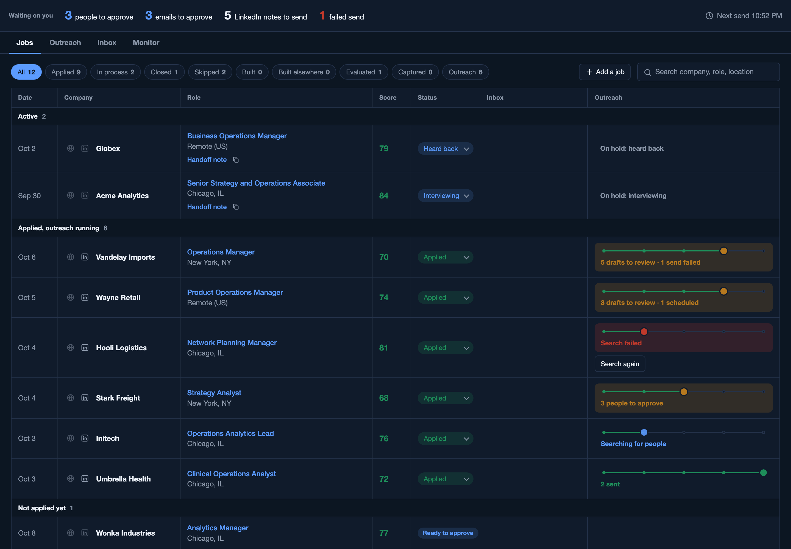
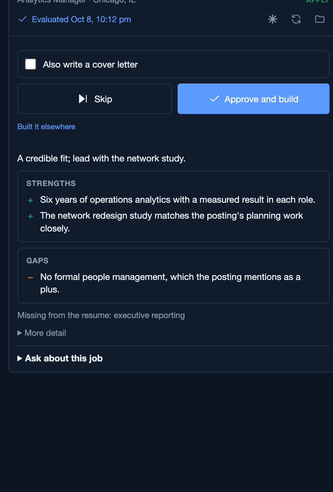
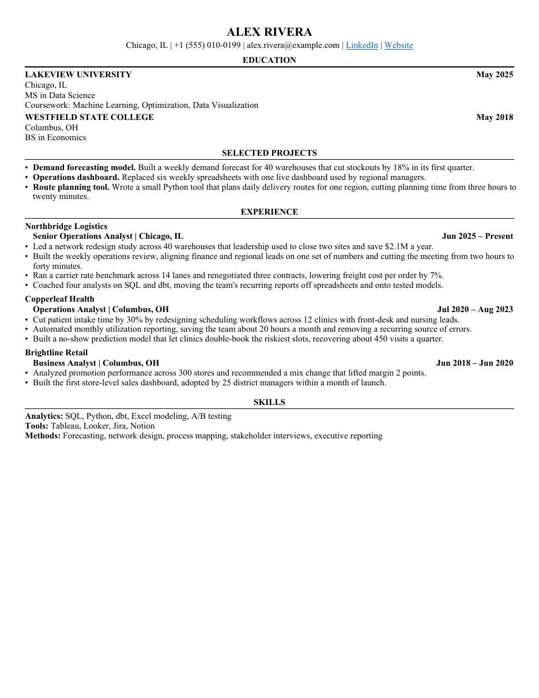
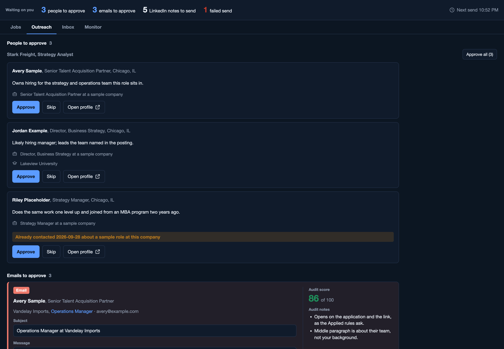

# jd-intake

A job-search assistant that runs on your own computer. You capture a job posting from your
browser; jd-intake tells you honestly whether it is worth applying, asks you at most three quick
questions, and builds a tailored one-page resume and cover letter from facts you have confirmed.
A dashboard tracks every application through to an offer. Optional modules find people to
contact, draft outreach you approve one by one, read replies from your inbox, and check visa
sponsorship. It learns from every edit you make.

It is built on [Claude Code](https://docs.claude.com/en/docs/claude-code): a small local server
calls Claude for the writing and judgment, and plain code does everything that can be checked
(page count, page fill, repeated lines, numbers traced to your profile, dates, send windows).

Nothing is ever submitted or sent without your click.

## What it looks like

Every screenshot shows the invented example person (Alex Rivera) and invented companies. You can open
the same demo yourself before setting anything up: `python3 server/demo.py`, then visit
http://127.0.0.1:8791/ (and http://127.0.0.1:8791/_panel for the side panel). It calls no model and no
paid service.

**The dashboard.** Every job, grouped by where it stands, with its fit score, stage and outreach progress.



<table>
<tr>
<td width="38%" valign="top">

**The side panel.** Open it on a job posting: capture, an honest evaluation with strengths and gaps,
then one click to build a tailored resume (and a cover letter if you want one).



</td>
<td width="62%" valign="top">

**A resume.** One page, every fact traced to your profile. This is the example person's base resume
before tailoring; a tailored build is fitted to fill the page.



</td>
</tr>
</table>

**Outreach (optional).** People worth contacting at a company you applied to, drafts with an audit
score, and nothing sent until you approve it.



## What it can do

**Capture.** A Chrome extension reads the posting you are looking at on LinkedIn, Greenhouse,
Lever, Ashby or Workday (and most other job pages, more roughly), shows you exactly what it
captured, and spots postings you have seen before. A keyboard shortcut (Ctrl+Shift+J, or
Command+Shift+J on a Mac) or a right-click on a job link captures without opening it.

**Evaluate.** Code first reads the posting for hard blockers (clearance, citizenship, contract
only, years far above yours) and settles what it can: the level, which tools you have confirmed,
which base resume fits. Then Claude scores the fit against your profile, with strengths, gaps, a
two-sentence honest take, and a Tailor, Base or Skip call. The score answers one question:
would this employer shortlist you today?

**Ask, then build once.** Anything the resume would need that your profile does not settle
(a tool the posting names, whether you have managed people) becomes a one-tap question. Then a
tailored resume is built: Claude writes the words, and the engine renders the document, measures
every line, and adjusts spacing until it is exactly one page and 92 to 98 percent full, with no
one-word last lines. It checks for em dashes, banned phrases, role order, repeated bullets and
every number against your profile. A cover letter can be built from your own building blocks,
250 to 350 words, one page.

**Form answers.** Your common answers (work authorization, start date, relocation) live in one
file the skills use. A draft `apply` skill can fill a form in your own Chrome through Claude in
Chrome and stop before Submit.

**Track.** The dashboard at `http://127.0.0.1:8790` lists every job with its stage: captured,
scored, built, applied, then Heard back, Assessment, Interviewing, Offer, On hold, Rejected or
Withdrawn. Search covers every posting's full text. You can add jobs you applied to elsewhere.

**Outreach (optional, paid lookups).** After you apply, it can search the company's people on
LinkedIn through Apify, rank who is worth writing to (recruiters, the likely hiring manager,
alumni of your schools), look up work email addresses, and draft one email or LinkedIn note per
person. Each draft is checked, audited and fact-checked against your profile and the person's
own profile. You approve every email; it sends only on weekdays inside your send window, a few
per day. LinkedIn notes are never sent by software: you send them yourself.

**Email (optional).** Sends the emails you approved through your own mailbox over SMTP, and
reads your inbox over IMAP **read only** to track replies, rejections, interview invitations,
assessments and out-of-office replies, and to move jobs along their stages (each change can be
undone). It never replies to anyone and never writes to anyone at a company where you are in
process; replies to real conversations are always yours.

**Interview handoff notes.** When a job reaches an interview, it writes a `HANDOFF.md` in the
job's folder with the posting, the timeline, the people and emails so far, the resume you sent
(with its text) and what to prepare, ready to paste into a Claude chat for interview prep. It
keeps the note current as mail arrives.

**Sponsorship checks (optional).** For people who need a visa sponsor: looks up an employer's
past labor condition application filings from public US Department of Labor data, flags
sponsorship language in postings, and knows the exceptions some employers publish.

**Alerts (optional).** A Telegram message when something breaks, such as a Claude login that
expired or repeated failures, at most one per problem per hour.

**Self-learning.** When you edit an outreach draft before approving it, give feedback on a
resume or cover letter, apply to a job it scored low, or skip one it scored high, the server
records it. The `/learn` skill turns those into short, scoped rules ("for cold emails to
recruiters: ...") in your profile, which every prompt reads first. Over time the drafts sound
more like you.

## Three ways to run it

| | How | Good | Trade-off |
|---|---|---|---|
| **1. Your computer, Claude subscription** | Claude Code logged in with your Claude plan | Easiest. Usage counts against your plan, no per-call bill | Your computer must be on for the server to work; heavy use can reach your plan's usage limits |
| **2. Your computer, API key** | `ANTHROPIC_API_KEY` in the environment | Easy, no subscription needed | Billed per use. See costs below |
| **3. A home or cloud server** | The same server on an always-on machine, reached through an SSH tunnel | Inbox reading and sending keep going when your laptop sleeps | More setup; opening files and Desktop copies happen on the server, not your laptop. Guidance only |

Details: [docs/run-locally.md](docs/run-locally.md), [docs/api-key-mode.md](docs/api-key-mode.md),
[docs/server-mode.md](docs/server-mode.md).

### What API-key mode costs, roughly

Every Claude call is billed at [Anthropic's API prices](https://www.anthropic.com/pricing).
Per action, from cheapest to most expensive:

- **Evaluate a posting:** one call with the posting and your profile inline. The cheapest step.
- **Build a resume:** one writing call, plus up to two short fix rounds when a line does not fit.
- **Cover letter:** one call, plus up to two short fix rounds.
- **Interview handoff note:** one short call per update.
- **Inbox reading (email on):** a short sorting call for new mail, every 30 minutes.
- **Outreach for one job:** the most expensive. Drafting, auditing, fact-checking and one
  revision round, for every person, on the most capable model by default.

The server records Claude's own cost estimate on each evaluation, build and cover letter, so
after a few jobs you will know your real numbers. To spend less, set cheaper models in the
`models` block of `profile/profile.yaml` (for example `outreach: sonnet`).

## Quick start

You need Python 3.10 or newer, LibreOffice, Poppler, Google Chrome and Claude Code.

```bash
git clone <this repository> jd-intake
cd jd-intake
python3 -m pip install -r requirements.txt
claude                      # then type /onboard
```

`/onboard` checks the prerequisites and says how to install anything missing, reads your
existing resume (PDF or DOCX) or LinkedIn PDF export, interviews you in short batches for the
rest, writes your profile, builds one to three base resumes and renders each until it fits one
full page, asks which optional features you want, and tailors the skills to you. You can stop
and run it again; it carries on where it left off.

Then:

```bash
python3 server/app.py       # serves http://127.0.0.1:8790
```

In Chrome, open `chrome://extensions`, turn on Developer mode, click **Load unpacked** and pick
the `extension/` folder. Open a job posting and click the extension's icon.

## Where things live

| Path | What | In git? |
|---|---|---|
| `profile/` | Everything about you: claims, base resumes, voice, learnings, skill addenda | No |
| `data/` | The job database, one folder per application, the learning inbox | No |
| `.env` | Secrets for optional features (see `.env.example`) | No |
| `.claude/skills/` | The generic skills: onboard, skill-builder, learn, evaluate-jd, resume-build, cover-letter-build, apply | Yes |
| `server/`, `engine/`, `extension/`, `plugins/` | The code | Yes |
| `examples/profile/` | An invented person, used by the tests and as the format reference | Yes |

More: [docs/architecture.md](docs/architecture.md), [docs/api.md](docs/api.md).

## Privacy

Your profile, your applications and your secrets stay on your machine, in folders git ignores.
What leaves it:

- **To Anthropic:** the text of each Claude call, which includes the posting and the parts of
  your profile the task needs. Your Claude plan or API terms apply.
- **To Apify (outreach only):** the company's LinkedIn page, job titles to search for, your
  schools, and the people you approve for an email lookup.
- **To your mail provider (email only):** the emails you approved, and read-only access to your
  inbox and sent mail.
- **To Telegram (alerts only):** short failure messages.

Nothing is sent to the authors of this project. Full detail: [docs/privacy.md](docs/privacy.md).

## Costs of the optional paid features

- **Outreach** uses Apify actors billed per result to your Apify account: a people search per
  job, and an email lookup per person you approve. Expect cents to a few tens of cents per job;
  the dashboard's Monitor tab shows what each run actually cost. See
  [docs/outreach.md](docs/outreach.md).
- **Email, sponsorship and alerts** cost nothing beyond the accounts you already have.

## Your responsibilities

Outreach and email act in your name. LinkedIn's terms, anti-spam law (such as CAN-SPAM in the
US) and your mail provider's limits apply to you. Both features are off until you turn them on,
and nothing is sent without your approval. Read [docs/outreach.md](docs/outreach.md) and
[docs/email.md](docs/email.md) first.

## More documentation

- [How it learns](docs/how-it-learns.md)
- [Outreach](docs/outreach.md), [Email](docs/email.md), [Sponsorship](docs/sponsorship.md),
  [Alerts](docs/alerts.md)
- [Contributing](CONTRIBUTING.md)

## License

MIT. See [LICENSE](LICENSE).
